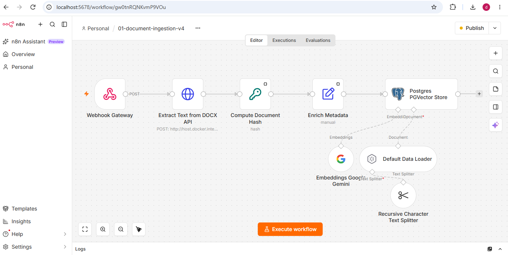
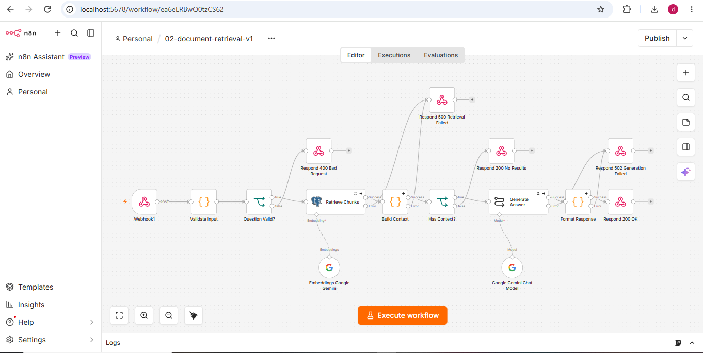
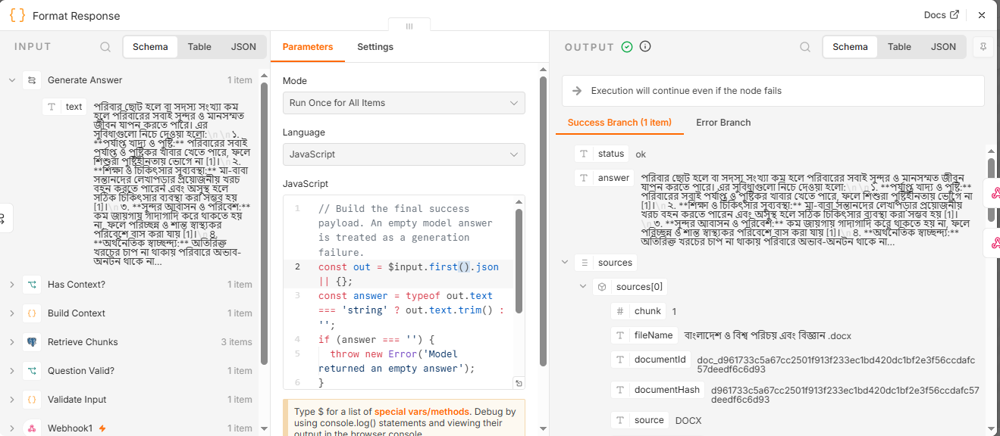

# Advanced RAG Knowledge Base Assistant

An AI-powered knowledge base assistant built with **n8n, Google Gemini, Supabase PostgreSQL with pgvector, and Python FastAPI**. It processes DOCX documents and generates context-grounded answers with source information using Retrieval-Augmented Generation (RAG).

## Overview

This project demonstrates an end-to-end RAG pipeline: document ingestion, vector storage, semantic retrieval, and AI-powered question answering. It uses two n8n workflows connected to a shared Supabase pgvector table.

- **Document Ingestion:** Extracts DOCX text, computes a SHA-256 hash, enriches metadata, splits text into chunks, generates embeddings, and stores them in the vector database.
- **RAG Retrieval:** Validates questions, retrieves relevant chunks, builds context, and generates answers with Google Gemini.

A Python FastAPI service extracts text from DOCX files, including Bengali content.

## Key Features

- Bengali and English DOCX text extraction
- SHA-256 document hashing and metadata enrichment
- Recursive text splitting with configurable chunk size and overlap
- Google Gemini embeddings stored in PostgreSQL with pgvector
- Webhook-based document ingestion and question submission
- Context-grounded answers with source information
- Fallback response when the retrieved context does not contain sufficient information
- Bengali question answering using Bengali source documents
- English question answering using Bengali source documents

## Screenshots







## Architecture

### Document Ingestion

```text
Webhook Gateway → DOCX Extraction API → Compute Document Hash → Enrich Metadata
→ Text Splitting → Gemini Embeddings → Supabase PGVector Store
```

### RAG Retrieval

```text
Question Webhook → Validate Input → Retrieve Relevant Chunks → Build Context
→ Check Context Availability → Generate Answer → Format Response → Respond to Webhook
```

If the available context is insufficient, the retrieval workflow returns a fallback response instead of presenting unsupported information as fact.

See [docs/architecture.md](docs/architecture.md) for architecture details.

## Technology Stack

- **Workflow Automation:** n8n
- **AI Models:** Google Gemini
- **Chat Model:** `gemini-3-flash-preview`
- **Embedding Model:** `gemini-embedding-001`
- **Vector Database:** Supabase PostgreSQL with pgvector
- **Backend API:** Python and FastAPI
- **DOCX Processing:** python-docx
- **Containerization:** Docker Desktop
- **API Testing:** Postman

The `gemini-3-flash-preview` Chat Model is also used in the Telegram Bot and AI Lead Qualification portfolio projects.

## Chunking and Vector Storage

| Component | Configuration |
|---|---|
| Text Splitter | Recursive Character Text Splitter |
| Chunk Size | 1,000 characters |
| Chunk Overlap | 200 characters |
| Embedding Model | `gemini-embedding-001` |
| Embedding Dimensions | 3,072 |
| Vector Table | `public.rag_document_vectors` |
| Stored Chunks in Evaluation Dataset | 195 |

The sample Bengali educational DOCX document was processed and stored in Supabase pgvector.

The embedding dimensions must match the database vector column.

**Indexing limitation:** Standard pgvector `vector` indexing with HNSW and IVFFlat supports up to 2,000 dimensions. The current 3,072-dimensional embeddings therefore require an alternative indexing strategy or exact search. This should be considered before scaling to larger knowledge bases.

## Evaluation Results

**Evaluation Date:** 2026-11-07

The RAG workflow was manually evaluated using 13 questions.

| Evaluation Metric | Result |
|---|---:|
| Total Questions | 13 |
| Answerable Questions Passed | 10/10 |
| Unanswerable Questions Correctly Abstained | 3/3 |
| Total Questions Correctly Answered or Abstained | 13/13 |
| Observed Hallucinated Answers | 0 |

### Tested Capabilities

- Direct factual question answering
- Combined and paraphrased questions
- Bengali question answering
- English question answering using Bengali document content
- Population statistics retrieval
- Abstention when requested information was not available in the document

### Evaluation Observations

All three unanswerable questions were correctly handled without generating unsupported factual answers.

However, some abstention responses included citations to irrelevant retrieved chunks. Therefore, correct abstention does not necessarily mean that every displayed source citation was relevant.

These results apply only to the 13 manually tested questions. They do not establish 100% overall RAG accuracy or production reliability.

See [test-results/day5-rag-eval.md](test-results/day5-rag-eval.md) for the detailed evaluation report.

## Known Limitations

- Retrieval sometimes returns less relevant chunks alongside relevant chunks.
- Some unanswerable responses include citations to irrelevant retrieved chunks.
- Citation-number-to-source-chunk mapping has not been independently verified.
- The exact Bengali fallback response has not been separately verified.
- Standard HNSW and IVFFlat indexing is limited to 2,000 dimensions for the standard pgvector `vector` type. The current 3,072-dimensional embeddings require an alternative indexing strategy or exact search.
- A fresh standalone SHA256 execution was not performed during the Day 5 evaluation; the existing ingestion hash and node configuration were verified.
- Evaluation coverage is limited to 13 manually tested questions.

## Provider Availability

The originally configured retrieval Chat Model was `gemini-3.8-flash`.

During evaluation, requests returned:

`503 Service Unavailable — model is currently experiencing high demand.`

The Chat Model was changed to:

`gemini-3-flash-preview`

The new model successfully generated the subsequent tested answers.

This was recorded as a provider/model availability issue, not as a verified workflow logic failure.

## Local Setup

### Prerequisites

- Docker Desktop
- n8n
- Python 3.10+
- Google Gemini API key
- Supabase project with pgvector
- Postman or another HTTP client

### 1. Start n8n

If your existing Docker container is named `n8n`, run:

```bash
docker start n8n
```

Open [http://localhost:5678](http://localhost:5678).

For a new installation, follow the [official n8n Docker guide](https://docs.n8n.io/hosting/installation/docker/).

### 2. Start the DOCX Extraction API

Install the required dependencies:

```bash
python -m pip install fastapi uvicorn python-docx python-multipart
```

Start the API from the project directory:

```bash
python -m uvicorn docx_extraction_api:app --host 0.0.0.0 --port 8000
```

Check the health endpoint:

[http://localhost:8000/health](http://localhost:8000/health)

The ingestion workflow calls:

```text
http://host.docker.internal:8000/extract-docx
```

This address allows Docker Desktop to reach the API running on the host machine. It is a local development address, not a production endpoint.

### 3. Configure Credentials

Configure Google Gemini and Supabase PostgreSQL credentials in n8n.

`.env.example` is only a reference; its placeholders do not configure n8n credentials automatically.

Never publish actual API keys, passwords, or access tokens.

### 4. Prepare the Vector Table

The following is an illustrative schema for a **new table**. Inspect your existing Supabase schema first. This SQL does not alter an existing table.

```sql
create extension if not exists vector;

create table if not exists public.rag_document_vectors (
    id uuid primary key default gen_random_uuid(),
    text text,
    metadata jsonb,
    embedding vector(3072)
);
```

For the current 3,072-dimensional embeddings, conventional HNSW and IVFFlat indexing on the standard `vector` type is not supported. Exact search can be used for small knowledge bases.

### 5. Import the Workflows

The sanitized workflow exports intended for repository publication are located in the `workflows/` directory:

- `workflows/01-document-ingestion-v4-SANITIZED.json`
- `workflows/02-document-retrieval-v1-SANITIZED.json`

Original unsanitized exports should be retained locally as backups and excluded from the public repository.

Import the sanitized JSON files into n8n.

After importing:

1. Assign your own Google Gemini credentials.
2. Assign your own Supabase PostgreSQL credentials.
3. Verify the webhook paths.
4. Confirm the DOCX API URL.
5. Verify the vector table and embedding configuration.

Imported workflows may require instance-specific adjustments before execution.

## Usage

Replace the example webhook paths with the actual paths configured in n8n. Use the test webhook URL when running in n8n test mode.

### Ingest a DOCX Document

The form field name must match the webhook configuration.

```bash
curl -X POST "http://localhost:5678/webhook-test/ingest-document" \
  -F "file=@sample.docx"
```

### Ask a Question

The retrieval workflow uses the `ask-question` webhook path.

```bash
curl -X POST "http://localhost:5678/webhook-test/ask-question" \
  -H "Content-Type: application/json" \
  -d "{\"question\":\"What does the document say about population?\"}"
```

For production webhook execution, use the production webhook URL shown by n8n instead of the test URL.

## Testing

The project includes:

- `test_docx_text.py`: Checks DOCX text extraction.
- `test-data/rag-test-questions.json`: Example questions and expected retrieval behavior. This is test data, not an automated test runner.
- `test-results/day5-rag-eval.md`: Manual RAG evaluation report.
- `screenshots/`: Workflow and response evidence.

The Day 5 evaluation covered 13 manually tested questions. See the evaluation report for individual results and limitations.

## Security

- Never commit API keys, passwords, or access tokens.
- Keep local secrets excluded through `.gitignore`.
- Do not publish original unsanitized workflow exports.
- Review sanitized n8n workflow JSON files before publishing.
- Check for API keys, database URLs, email addresses, instance identifiers, and other personal or environment-specific information.
- Secure public-facing webhooks and APIs before production deployment.

## Future Improvements

Potential future improvements include:

- Support for additional document formats.
- Document update and deletion workflows.
- Automated integration tests.
- Improved retrieval relevance and citation mapping.
- More robust fallback response handling.
- Improved logging and error handling.
- Alternative indexing strategies for larger vector collections.
- Performance optimization for larger knowledge bases.

These are potential improvements, not implemented features.

## License

This project is licensed under the MIT License. See [LICENSE](LICENSE) for details.