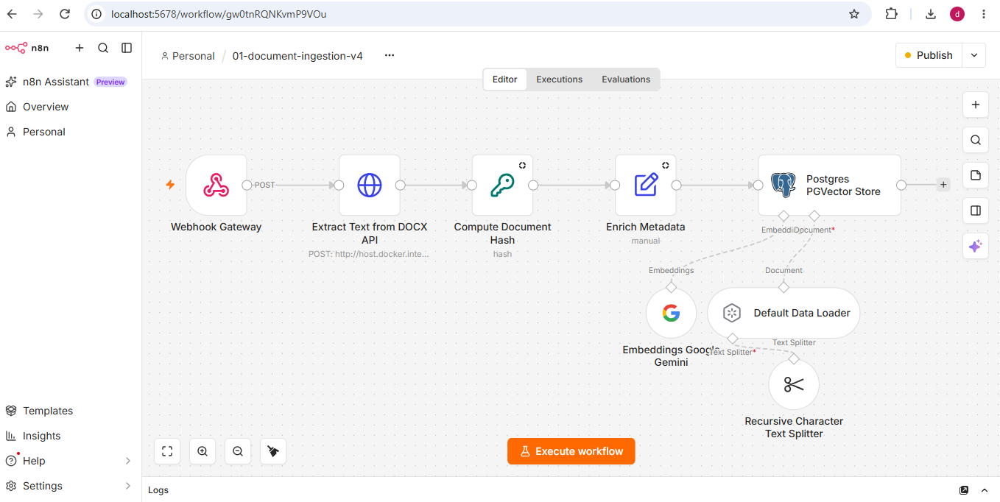
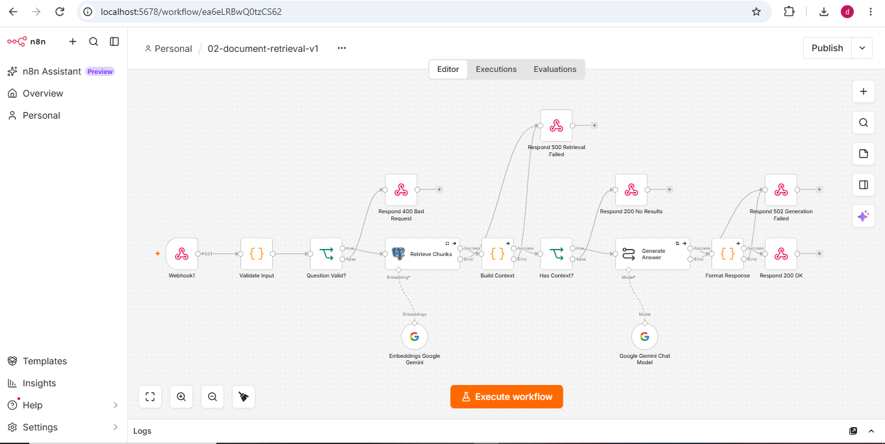
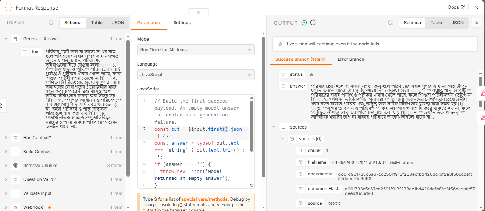

# Advanced RAG Knowledge Base Assistant

An AI-powered knowledge base assistant built with **n8n, Google Gemini, Supabase PostgreSQL with pgvector, and Python FastAPI**. It processes DOCX documents and generates context-grounded answers with source information using Retrieval-Augmented Generation (RAG).

## Overview

This project demonstrates an end-to-end RAG pipeline: document ingestion, vector storage, semantic retrieval, and AI-powered question answering. It uses two n8n workflows connected to a shared Supabase pgvector table.

- **Document Ingestion:** extracts DOCX text, computes a SHA-256 hash, enriches metadata, splits text into chunks, generates embeddings, and stores them in the vector database.
- **RAG Retrieval:** validates questions, retrieves relevant chunks, builds context, and generates answers with Google Gemini.

A Python FastAPI service extracts text from DOCX files, including Bengali content.

## Key Features

- Bengali and English DOCX text extraction
- SHA-256 document hashing and metadata enrichment
- Recursive text splitting with configurable chunk size and overlap
- Google Gemini embeddings stored in PostgreSQL with pgvector
- Webhook-based document ingestion and question submission
- Context-grounded answers with source information
- Fallback response when relevant context is unavailable

## Screenshots





## Architecture

**Document Ingestion**

```text
Webhook Gateway → DOCX Extraction API → Compute Document Hash → Enrich Metadata
→ Text Splitting → Gemini Embeddings → Supabase PGVector Store
```

**RAG Retrieval**

```text
Question Webhook → Validate Input → Retrieve Relevant Chunks → Build Context
→ Check Context Availability → Generate Answer → Format Response → Respond to Webhook
```

If the available context is insufficient, the retrieval workflow returns a fallback response instead of presenting unsupported information as fact. See [docs/architecture.md](docs/architecture.md) for details.

**Stack:** n8n · Google Gemini · Supabase + pgvector · Python + FastAPI (python-docx) · Docker Desktop · Postman

## Chunking and Vector Storage

- **Text splitter:** Recursive Character Text Splitter
- **Chunk size / overlap:** 1,000 / 200 characters
- **Embedding model:** `gemini-embedding-001` (3,072 dimensions)
- **Vector table:** `public.rag_document_vectors`

The sample Bengali educational document produced approximately 30 chunks. The embedding dimensions must match the database vector column, and indexing options should be evaluated before scaling to larger datasets.

## Local Setup

**Prerequisites:** Docker Desktop and n8n, Python 3.10+, a Google Gemini API key, a Supabase project with pgvector, and Postman or another HTTP client.

### 1. Start n8n

If your existing Docker container is named `n8n`, run `docker start n8n` and open [http://localhost:5678](http://localhost:5678). For a new installation, follow the [official n8n Docker guide](https://docs.n8n.io/hosting/installation/docker/).

### 2. Start the DOCX extraction API

```bash
python -m pip install fastapi uvicorn python-docx python-multipart
python -m uvicorn docx_extraction_api:app --host 0.0.0.0 --port 8000
```

Check [http://localhost:8000/health](http://localhost:8000/health). The ingestion workflow calls `http://host.docker.internal:8000/extract-docx`, which lets Docker Desktop reach the API on your machine. This is a local development address, not a production endpoint.

### 3. Configure credentials

Add Google Gemini and Supabase PostgreSQL credentials in n8n. `.env.example` is only a reference; its placeholders do not configure n8n automatically.

### 4. Prepare the vector table

Illustrative schema for a **new** table. Inspect your existing Supabase schema first, as this does not alter an existing table:

```sql
create extension if not exists vector;

create table if not exists public.rag_document_vectors (
    id uuid primary key default gen_random_uuid(),
    text text,
    metadata jsonb,
    embedding vector(3072)
);
```

The standard `vector` type's HNSW and IVFFlat indexes support up to 2,000 dimensions, so no conventional index is available at 3,072. Exact search is fine for small knowledge bases.

### 5. Import the workflows

Import `workflow/01-document-ingestion-v4.json` and `workflow/02-document-retrieval-v1.json`. Then assign credentials, verify the webhook paths, confirm the DOCX API URL, and check the vector table settings. Imported workflows may need instance-specific adjustments.

## Usage

Replace the example webhook paths with the actual paths shown in n8n. Use the test webhook URL when running in n8n test mode.

**Ingest a DOCX document** (the form field name must match your webhook configuration):

```bash
curl -X POST "http://localhost:5678/webhook/<ingestion-path>" \
  -F "file=@sample.docx"
```

**Ask a question** (adjust the fields if your workflow expects a different structure):

```bash
curl -X POST "http://localhost:5678/webhook/<retrieval-path>" \
  -H "Content-Type: application/json" \
  -d "{\"question\":\"What does the document say about population?\"}"
```

## Testing

- `test_docx_text.py`: checks DOCX text extraction
- `test-data/rag-test-questions.json`: example questions and expected retrieval behavior (test data, not an automated test runner)
- `screenshots/`: workflow and response evidence

Record test results only after verifying the behavior.

## Security

- Never commit API keys, passwords, or access tokens; keep local secrets excluded through `.gitignore`.
- Review exported n8n workflow JSON files for instance-specific metadata before publishing.
- Secure public-facing webhooks and APIs before production deployment.

## Future Improvements

Support for additional document formats, document update and deletion workflows, automated integration tests, retrieval quality evaluation, improved logging and error handling, and performance optimization for larger datasets. These are potential improvements, not implemented features.

## License

This project is licensed under the MIT License. See [LICENSE](LICENSE) for details.